# Guide utilisateur du site SERA

Ce guide explique, pas à pas, comment utiliser le site de la boutique SERA : parcourir les collections, consulter un article, créer votre compte et vous connecter, consulter et modifier vos informations personnelles, vous déconnecter, s'inscrire à la newsletter et gérer vos choix en matière de cookies.

## Sommaire

1. [Présentation du site](#1-présentation-du-site)
2. [Naviguer entre les catégories](#2-naviguer-entre-les-catégories)
3. [Filtrer par type de vêtement](#3-filtrer-par-type-de-vêtement)
4. [Consulter une fiche produit](#4-consulter-une-fiche-produit)
5. [S'inscrire à la newsletter](#5-sinscrire-à-la-newsletter)
6. [Créer un compte et se connecter](#6-créer-un-compte-et-se-connecter)
7. [Le menu du compte](#7-le-menu-du-compte)
8. [Consulter et modifier ses informations (Mon compte)](#8-consulter-et-modifier-ses-informations-mon-compte)
9. [Se déconnecter](#9-se-déconnecter)
10. [Gérer les cookies](#10-gérer-les-cookies)
11. [Accéder aux pages légales](#11-accéder-aux-pages-légales)

---

## 1. Présentation du site

Le site SERA présente les collections de la boutique. La page d'accueil se lit de haut en bas :

- **Le bandeau d'annonce**, tout en haut, rappelle les avantages de la boutique (livraison offerte dès 50 €, retours gratuits).
- **L'en-tête** reste affiché en haut de l'écran pendant que vous faites défiler la page. Il contient le logo SERA et la liste des catégories.
- **La vidéo d'ouverture** présente l'univers de la boutique.
- **Les engagements SERA** résument la livraison, les retours, les moyens de paiement et le service client.
- **« Nos univers »** présente chaque catégorie sous forme d'une grande image cliquable.
- **« Derniers arrivages »** affiche les huit articles les plus récents.
- **Le bandeau de collection** met en avant la collection du moment.
- **Le pied de page** regroupe la newsletter, les liens utiles et les pages légales.

Pour revenir à l'accueil à tout moment, cliquez sur le logo **SERA** en haut à gauche. La page remonte alors tout en haut et la sélection de catégorie est effacée.

Le site s'adapte à la taille de l'écran : il peut être consulté sur ordinateur, tablette ou téléphone.

---

## 2. Naviguer entre les catégories

Il existe deux façons d'ouvrir une catégorie.

**Depuis l'en-tête**

1. Repérez la liste des catégories dans la barre du haut.
2. Cliquez sur le nom de la catégorie qui vous intéresse.

La catégorie choisie apparaît en surbrillance, et la page descend automatiquement jusqu'à la liste de ses articles.

**Depuis la section « Nos univers »**

1. Faites défiler l'accueil jusqu'à « Nos univers ».
2. Cliquez sur l'image de la catégorie (mention « Voir la collection »).

Une fois une catégorie ouverte, la liste affiche son nom en titre, suivi des articles sous forme de vignettes. Chaque vignette montre la photo de l'article et son prix. En passant la souris sur la photo, le nom de l'article s'affiche.

Pour changer de catégorie, cliquez simplement sur une autre catégorie dans l'en-tête. Si vous êtes sur une autre page du site (par exemple « Qui sommes-nous »), le choix d'une catégorie vous ramène à l'accueil, directement sur ses articles.

> **À savoir :** lorsqu'aucune catégorie n'est choisie, la liste affiche les « Derniers arrivages ». Si une catégorie ne contient aucun article pour le moment, le message « Aucun produit dans cette catégorie. » s'affiche.

---

## 3. Filtrer par type de vêtement

Lorsque vous avez ouvert une catégorie, une rangée de boutons apparaît au-dessus des articles. Elle propose les types de vêtements présents dans cette catégorie (par exemple « Pulls », « Pantalons », « Vestes »).

1. Cliquez sur un type pour n'afficher que les articles correspondants. Le bouton actif est mis en évidence.
2. Cliquez sur **« Tout »** pour afficher de nouveau tous les articles de la catégorie.

Le filtre se remet automatiquement sur « Tout » quand vous changez de catégorie. Les types proposés dépendent de la catégorie ouverte : seuls ceux qui contiennent des articles sont affichés.

---

## 4. Consulter une fiche produit

1. Dans la liste des articles, cliquez sur le bouton **« Voir le produit »** sous la vignette.
2. Une fenêtre s'ouvre par-dessus la page avec le détail de l'article.

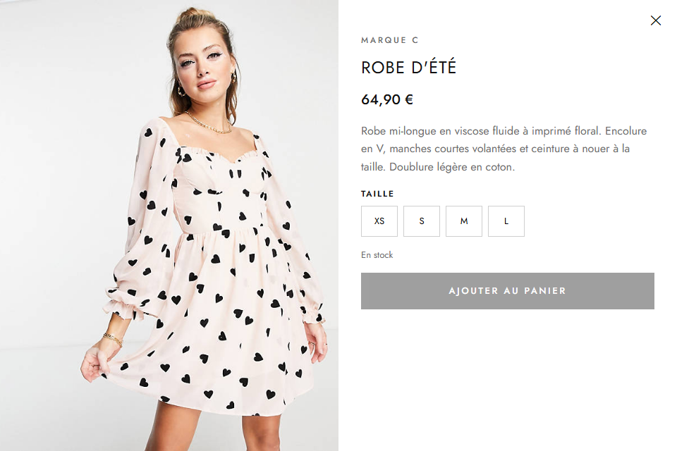

La fiche présente :

- la **photo** de l'article ;
- la **marque** et le **nom** de l'article ;
- le **prix**, en euros (par exemple « 89,00 € ») ;
- une **description** ;
- les **tailles** disponibles : cliquez sur une taille pour la sélectionner, elle est alors mise en évidence ;
- la **disponibilité** : « En stock » ou « Rupture de stock ».

Pour fermer la fiche, cliquez sur la croix en haut de la fenêtre, cliquez en dehors de la fenêtre (sur le fond sombre) ou appuyez sur la touche **Échap** de votre clavier.

> **À savoir :** la commande en ligne n'est pas encore ouverte. Le bouton « Ajouter au panier » est donc grisé sur les fiches. Pour toute question sur un article, contactez la boutique via les coordonnées indiquées dans les [mentions légales](#11-accéder-aux-pages-légales).

---

## 5. S'inscrire à la newsletter

La newsletter vous permet de recevoir les nouveautés en avant-première. Le formulaire se trouve en haut du pied de page, sous le titre **« Les nouveautés en avant-première »**.

1. Faites défiler la page jusqu'en bas.
2. Saisissez votre adresse e-mail dans le champ **« Adresse e-mail »**.
3. Cochez la case de consentement. Elle confirme que vous acceptez de recevoir les communications de SERA, conformément à la politique de confidentialité (un lien y mène).
4. Cliquez sur **« S'inscrire »**.

Un message de confirmation s'affiche : « Merci, votre inscription est enregistrée. »

Si l'inscription n'aboutit pas, un message en rouge vous explique pourquoi :

| Message affiché | Ce que cela signifie | Que faire |
|-----------------|----------------------|-----------|
| « Veuillez cocher la case de consentement pour vous inscrire. » | La case de consentement n'est pas cochée. | Cochez la case, puis recommencez. |
| « L'adresse e-mail n'est pas valide. » | L'adresse est vide ou mal écrite. | Vérifiez-la (elle doit ressembler à `nom@domaine.be`). |
| « Cette adresse e-mail est déjà inscrite. » | Vous êtes déjà abonné(e) avec cette adresse. | Aucune action nécessaire. |

Vos données sont utilisées uniquement pour l'envoi de la newsletter. Pour connaître vos droits (accès, rectification, suppression) et la façon de les exercer, consultez la page **Confidentialité**.

---

## 6. Créer un compte et se connecter

### Créer un compte

Vous pouvez créer votre compte client depuis n'importe quelle page du site. Un compte n'est pas nécessaire pour consulter les collections.

1. Cliquez sur l'icône **« Mon compte »** (le bonhomme) en haut à droite de l'en-tête.
2. En bas de la fenêtre **« Connexion »**, cliquez sur **« Créer un compte »**.

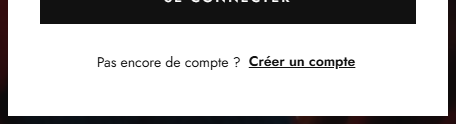

3. Dans la fenêtre **« Créer un compte »**, remplissez les sept champs. **Tous sont obligatoires** :
   - **Nom** et **Prénom** ;
   - **Adresse** (rue et numéro), **Code postal** et **Ville** ;
   - **Adresse e-mail** : elle vous servira d'identifiant pour vous connecter ;
   - **Mot de passe** : **8 caractères minimum**. Votre navigateur peut vous en proposer un.
4. Cliquez sur **« Créer mon compte »**. Pendant l'envoi, le bouton affiche « Création… ».

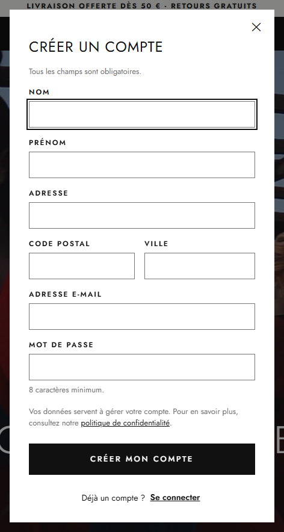

Si l'inscription réussit, la fenêtre se ferme et **vous êtes directement connecté(e)** : l'en-tête affiche **« Bienvenue, » suivi de votre prénom**, sur toutes les pages du site. Vous n'avez pas besoin de vous connecter une seconde fois.

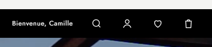

Si l'inscription n'aboutit pas, un message en rouge s'affiche dans la fenêtre et le curseur se place sur le champ à corriger. Les champs déjà remplis sont conservés. En cas de refus par le serveur (par exemple une adresse déjà utilisée), le mot de passe est effacé et doit être ressaisi par sécurité.

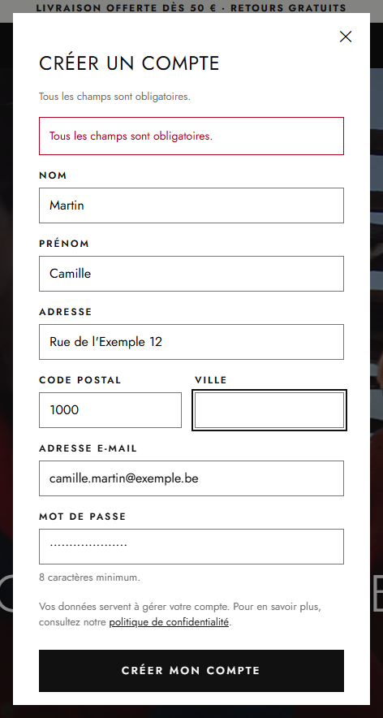

| Message affiché | Ce que cela signifie | Que faire |
|-----------------|----------------------|-----------|
| « Tous les champs sont obligatoires. » | Au moins un champ est vide. | Remplissez le champ indiqué par le curseur. |
| « L'adresse e-mail n'est pas valide. » | L'adresse saisie n'a pas la forme nom@domaine.be. | Corrigez l'adresse e-mail. |
| « Le mot de passe doit contenir au moins 8 caractères. » | Le mot de passe est trop court. | Choisissez un mot de passe plus long. |
| « Le mot de passe est trop long. » | Le mot de passe dépasse la longueur acceptée. | Choisissez un mot de passe plus court. |
| « Un compte existe déjà avec cette adresse e-mail. » | Un compte a déjà été créé avec cette adresse : deux comptes ne peuvent pas partager la même adresse e-mail. | Connectez-vous avec cette adresse, ou utilisez-en une autre. |
| « Inscription impossible pour le moment. Veuillez réessayer plus tard. » | Le site ne parvient pas à joindre le serveur. | Réessayez dans quelques instants. |

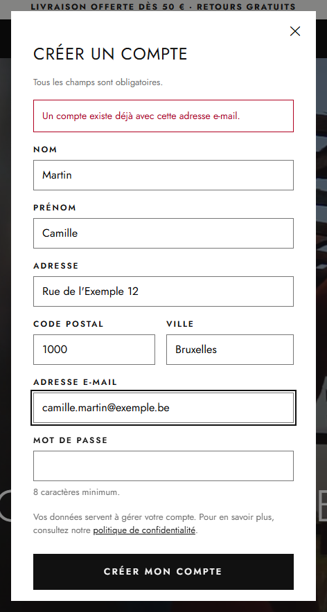

Si vous avez déjà un compte, le lien **« Se connecter »**, en bas de la fenêtre, vous ramène à la connexion. Pour savoir comment vos données sont utilisées, consultez la page **Confidentialité** (lien dans la fenêtre d'inscription et dans le pied de page).

### Se connecter

Si vous avez un compte, vous pouvez vous connecter depuis n'importe quelle page du site.

1. Cliquez sur l'icône **« Mon compte »** (le bonhomme) en haut à droite de l'en-tête.
2. Dans la fenêtre **« Connexion »**, saisissez votre **adresse e-mail** (elle sert d'identifiant) et votre **mot de passe**. Les deux champs sont obligatoires.
3. Cliquez sur **« Se connecter »**. Pendant l'envoi, le bouton affiche « Connexion… ».

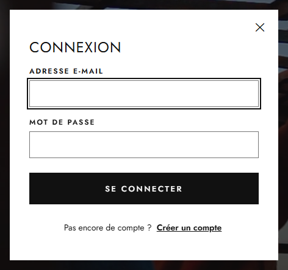

Si la connexion réussit, la fenêtre se ferme, vous restez sur la page où vous étiez et l'en-tête affiche **« Bienvenue, » suivi de votre prénom**, sur toutes les pages du site. Si vous rechargez la page, vous restez connecté(e) tant que votre session n'a pas expiré.

Si la connexion n'aboutit pas, un message en rouge s'affiche dans la fenêtre :

| Message affiché | Ce que cela signifie | Que faire |
|-----------------|----------------------|-----------|
| « L'email et le mot de passe sont obligatoires. » | Un des deux champs est vide. | Remplissez les deux champs. |
| « Email ou mot de passe incorrect » | Les identifiants ne correspondent à aucun compte. Par sécurité, le site ne précise pas lequel des deux est faux. | Vérifiez votre saisie, puis recommencez. |
| « Connexion impossible pour le moment. Veuillez réessayer plus tard. » | Le site ne parvient pas à joindre le serveur. | Réessayez dans quelques instants. |

Après un identifiant ou un mot de passe incorrect, le champ « Mot de passe » est vidé et le curseur s'y place, pour que vous puissiez le ressaisir.

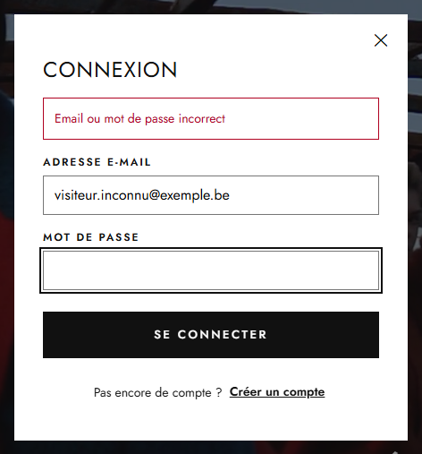

Vous pouvez fermer la fenêtre de connexion ou d'inscription avec la croix ✕, en cliquant à côté de la fenêtre ou avec la touche Échap. Au clavier, la touche Tab fait circuler le focus uniquement dans la fenêtre. Une fois connecté(e), l'icône « Mon compte » n'ouvre plus la fenêtre de connexion : elle ouvre le [menu du compte](#7-le-menu-du-compte).

---

## 7. Le menu du compte

Une fois connecté(e), l'icône **« Mon compte »** (le bonhomme) ouvre un petit menu juste en dessous. Il propose deux choix :

- **« Paramètres »** : ouvre la page **Mon compte**, où vous consultez et modifiez vos informations (voir la [section 8](#8-consulter-et-modifier-ses-informations-mon-compte)) ;
- **« Se déconnecter »** : met fin à votre session (voir la [section 9](#9-se-déconnecter)).

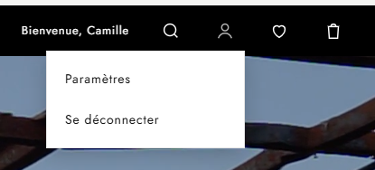

Pour fermer le menu sans rien choisir, cliquez de nouveau sur l'icône, cliquez ailleurs sur la page ou appuyez sur la touche **Échap**.

Au clavier : à l'ouverture du menu, « Paramètres » est sélectionné ; la touche **Tab** passe à « Se déconnecter » et **Maj + Tab** revient à « Paramètres ». La touche **Entrée** valide le choix.

---

## 8. Consulter et modifier ses informations (Mon compte)

La page **Mon compte** regroupe les informations de votre compte. Elle est réservée aux membres connectés.

**Ouvrir la page**

1. Cliquez sur l'icône **« Mon compte »** en haut à droite.
2. Dans le menu, cliquez sur **« Paramètres »**.

La page affiche, sous le titre **« Vos informations personnelles »**, six champs préremplis : **Prénom**, **Nom**, **Adresse e-mail**, **Adresse**, **Code postal** et **Ville**. Plus bas, la section [**« Modifier mon mot de passe »**](#modifier-votre-mot-de-passe) permet de changer votre mot de passe.

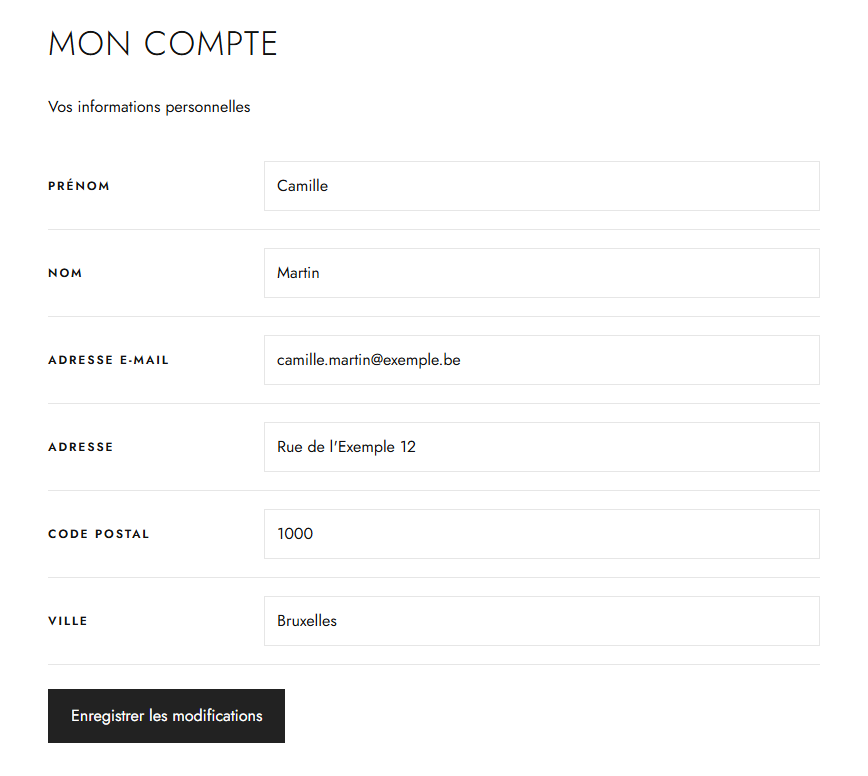

**Modifier vos informations**

1. Corrigez le ou les champs souhaités.
2. Cliquez sur **« Enregistrer les modifications »**. Pendant l'envoi, le bouton affiche « Enregistrement… » et les champs ne sont plus modifiables.

Si l'enregistrement réussit, le message **« Vos informations ont été mises à jour. »** s'affiche en haut du formulaire et le curseur se place sur ce message. Il disparaît dès que vous modifiez de nouveau un champ.

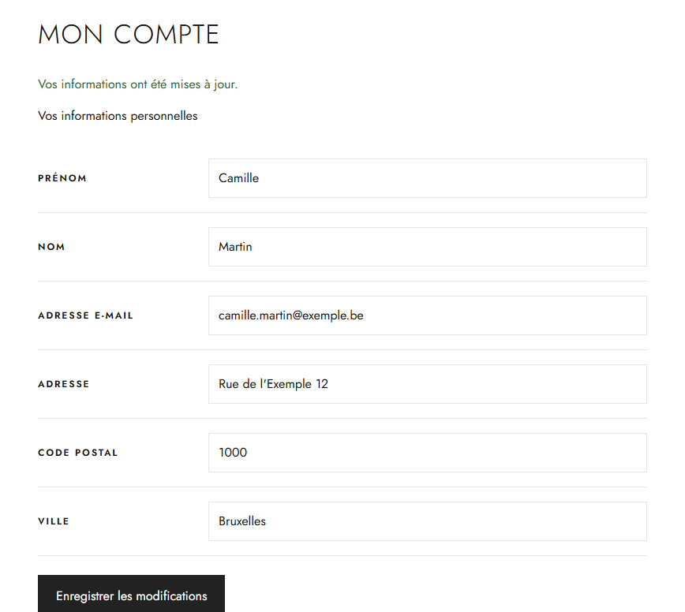

Bon à savoir :

- Si vous changez votre **prénom**, la mention « Bienvenue, » de l'en-tête est mise à jour aussitôt.
- Si vous changez votre **adresse e-mail**, c'est la nouvelle adresse qui vous servira pour vous connecter la prochaine fois. Vous restez connecté(e) pendant le changement.
- Vos modifications sont enregistrées : elles restent affichées si vous rechargez la page ou si vous revenez plus tard.
- Le **mot de passe** se modifie à part, avec son propre formulaire : le bouton « Enregistrer les modifications » ne le change pas.

**Règles à respecter**

- **Les six champs sont obligatoires.** Un champ ne peut pas rester vide ni contenir uniquement des espaces.
- L'adresse e-mail doit avoir la forme `nom@domaine.be`, et ne doit pas être celle d'un autre compte.
- Les longueurs sont limitées : 10 caractères pour le code postal, 100 pour le prénom, le nom et la ville, 255 pour l'adresse et l'adresse e-mail. Le formulaire empêche de saisir davantage.
- Les espaces au début et à la fin des champs sont retirés, et l'adresse e-mail est enregistrée en minuscules.

**Si l'enregistrement n'aboutit pas**

Si un champ est vide, ou si l'adresse e-mail ne contient pas d'arobase (@), votre navigateur signale le champ à corriger (par exemple « Veuillez renseigner ce champ. ») et rien n'est envoyé. Dans les autres cas, un message en rouge s'affiche en haut du formulaire et le curseur se place sur le champ à corriger (sur « Prénom » si aucun champ précis n'est en cause, par exemple quand le serveur ne répond pas). Vos saisies sont conservées pour que vous puissiez les corriger.

| Message affiché | Ce que cela signifie | Que faire |
|-----------------|----------------------|-----------|
| « Tous les champs sont obligatoires. » | Un champ ne contient que des espaces. | Remplissez le champ indiqué par le curseur. |
| « L'adresse e-mail n'est pas valide. » | L'adresse n'a pas la forme `nom@domaine.be` (par exemple, l'extension « .be » manque). | Corrigez l'adresse e-mail. |
| « Un compte existe déjà avec cette adresse e-mail. » | Cette adresse appartient déjà à un autre compte. | Utilisez une autre adresse. |
| « Impossible d'enregistrer les modifications. Veuillez réessayer. » | Le site ne parvient pas à joindre le serveur. | Réessayez dans quelques instants. |
| « Impossible de charger vos informations. Veuillez réessayer. » | Vos informations n'ont pas pu être affichées à l'ouverture de la page. | Cliquez sur le bouton **« Réessayer »** qui s'affiche sous le message. |

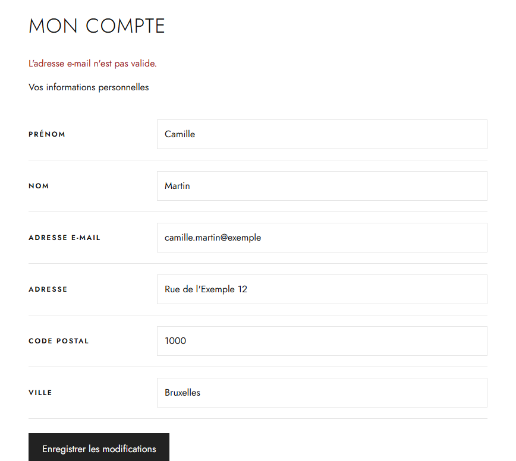

### Modifier votre mot de passe

La section **« Modifier mon mot de passe »** se trouve sur la page Mon compte, sous vos informations personnelles.

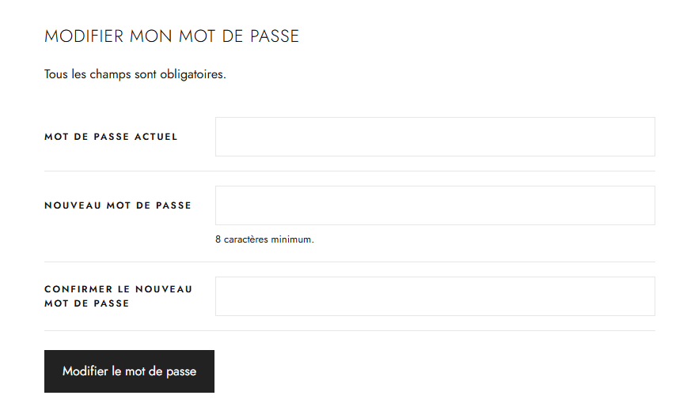

1. Dans **« Mot de passe actuel »**, saisissez le mot de passe que vous utilisez aujourd'hui pour vous connecter.
2. Dans **« Nouveau mot de passe »**, saisissez le mot de passe que vous voulez utiliser désormais. Votre navigateur peut vous en proposer un.
3. Dans **« Confirmer le nouveau mot de passe »**, saisissez-le une seconde fois, à l'identique.
4. Cliquez sur **« Modifier le mot de passe »**. Pendant l'envoi, le bouton affiche « Modification… » et les champs ne sont plus modifiables.

Si le changement réussit, le message **« Votre mot de passe a été modifié. »** s'affiche en haut de la section et le curseur se place sur ce message. **Vous restez connecté(e)**. À votre prochaine connexion, utilisez le nouveau mot de passe : l'ancien n'est plus accepté.

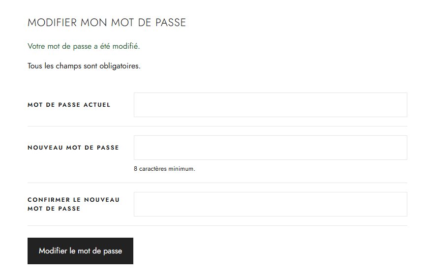

**Règles à respecter**

- **Les trois champs sont obligatoires.**
- Le nouveau mot de passe compte **8 caractères minimum** et 72 caractères au maximum (moins s'il contient des lettres accentuées ou des symboles spéciaux).
- La confirmation doit être identique au nouveau mot de passe, majuscules et minuscules comprises.
- Le nouveau mot de passe doit être différent de l'actuel.
- Les espaces font partie du mot de passe : ils ne sont pas retirés.

**Si le changement n'aboutit pas**

Un message en rouge s'affiche en haut de la section et votre mot de passe reste inchangé. Vous restez connecté(e).

Quel que soit le message, les trois champs sont vidés et le curseur revient sur **« Mot de passe actuel »** : ressaisissez les trois mots de passe.

| Message affiché | Ce que cela signifie | Que faire |
|-----------------|----------------------|-----------|
| « Tous les champs sont obligatoires. » | Au moins un des trois champs est vide. | Remplissez les trois champs. |
| « Le mot de passe actuel est incorrect. » | Le premier champ ne correspond pas à votre mot de passe. | Saisissez de nouveau votre mot de passe actuel. |
| « Le mot de passe doit contenir au moins 8 caractères. » | Le nouveau mot de passe est trop court. | Choisissez un mot de passe plus long. |
| « Le mot de passe est trop long. » | Le nouveau mot de passe dépasse la longueur acceptée. | Choisissez un mot de passe plus court. |
| « La confirmation ne correspond pas au nouveau mot de passe. » | Les deux saisies du nouveau mot de passe sont différentes. | Saisissez-les de nouveau, à l'identique. |
| « Le nouveau mot de passe doit être différent de l'actuel. » | Vous avez repris votre mot de passe actuel. | Choisissez un autre mot de passe. |
| « Impossible de modifier le mot de passe. Veuillez réessayer plus tard. » | Le site ne parvient pas à joindre le serveur. | Réessayez dans quelques instants. |

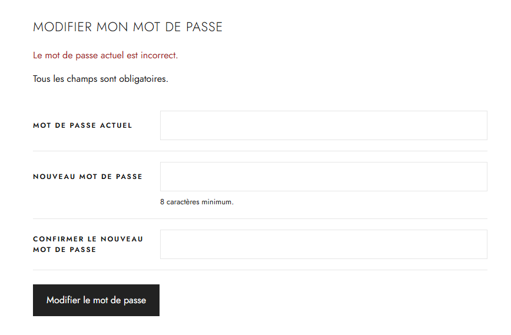

Par sécurité, **les trois champs sont vidés après chaque tentative**, réussie ou non. Le message disparaît à la tentative suivante ; la confirmation disparaît aussi dès que vous saisissez de nouveau.

> **À savoir :** si vous ouvrez l'adresse de la page Mon compte sans être connecté(e), vous êtes ramené(e) à l'accueil et la fenêtre de connexion s'ouvre. Si votre session a expiré pendant que vous étiez sur la page, vous êtes ramené(e) à l'accueil : reconnectez-vous, puis recommencez la modification.

---

## 9. Se déconnecter

1. Cliquez sur l'icône **« Mon compte »** en haut à droite.
2. Dans le menu, cliquez sur **« Se déconnecter »**.

La mention « Bienvenue, » disparaît de l'en-tête : vous êtes de nouveau simple visiteur. Vous restez sur la page où vous étiez, sauf si vous étiez sur la page **Mon compte** : vous êtes alors ramené(e) à l'accueil, car cette page est réservée aux membres. Si vous rechargez la page, vous restez déconnecté(e).

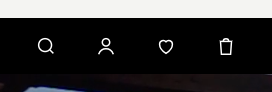

Après la déconnexion, l'icône « Mon compte » ouvre de nouveau la fenêtre de connexion.

Si le message **« Déconnexion impossible pour le moment. Veuillez réessayer plus tard. »** s'affiche dans le menu, le site n'a pas pu joindre le serveur : vous êtes toujours connecté(e). Réessayez dans quelques instants.

> **Conseil :** sur un ordinateur partagé, pensez à vous déconnecter à la fin de votre visite.

---

## 10. Gérer les cookies

Lors de votre première visite, un bandeau s'affiche en bas de l'écran : **« Vos choix en matière de cookies »**. Le site n'utilise que les cookies nécessaires à son fonctionnement ; d'autres ne peuvent être utilisés qu'avec votre accord.

- Cliquez sur **« Accepter »** pour autoriser les cookies supplémentaires.
- Cliquez sur **« Refuser »** pour n'utiliser que les cookies nécessaires.
- Cliquez sur **« En savoir plus »** pour lire la page **Cookies**, qui détaille leur usage.

Votre choix est mémorisé sur votre appareil : le bandeau ne s'affiche plus lors de vos visites suivantes.

**Modifier votre choix à tout moment**

1. Faites défiler la page jusqu'au pied de page.
2. Dans la ligne du bas, cliquez sur **« Gérer les cookies »**.
3. Le bandeau réapparaît : choisissez de nouveau « Accepter » ou « Refuser ».

> **À savoir :** si vous videz les données de votre navigateur, ou si vous changez de navigateur ou d'appareil, le bandeau s'affichera de nouveau.

---

## 11. Accéder aux pages légales

Les pages légales sont accessibles depuis la ligne du bas du pied de page, sur toutes les pages du site.

| Lien | Contenu |
|------|---------|
| **Mentions légales** | Identité de la société, coordonnées, hébergeur du site. |
| **Conditions générales de vente** | Règles applicables aux achats. |
| **Confidentialité** | Données personnelles collectées, finalités et droits. |
| **Cookies** | Cookies utilisés et façon de gérer votre choix. |

La page **« Qui sommes-nous »**, qui présente la boutique, est accessible depuis la colonne « À propos » du pied de page.

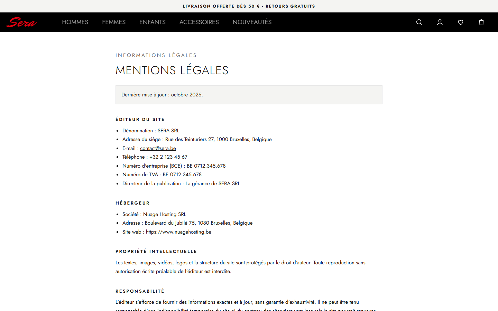

Chaque page légale s'ouvre automatiquement en haut, quel que soit l'endroit du pied de page où vous avez cliqué.

---

## Besoin d'aide ?

Pour toute question sur le site ou sur vos données personnelles, contactez SERA aux coordonnées indiquées dans les **Mentions légales**.
