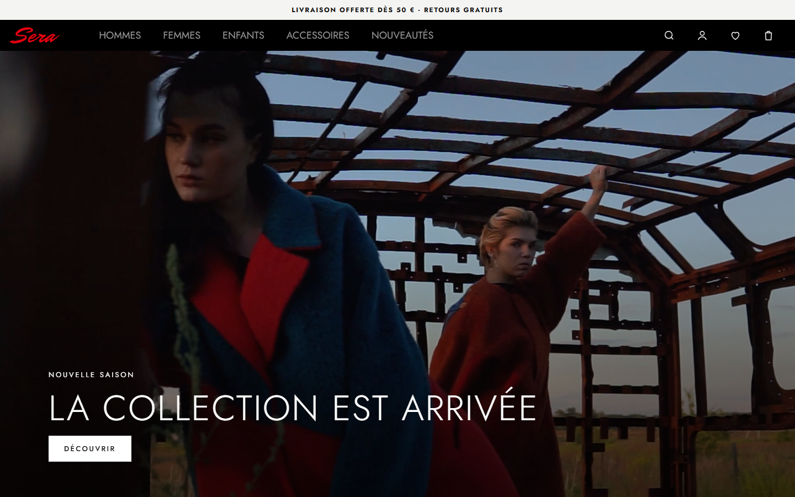
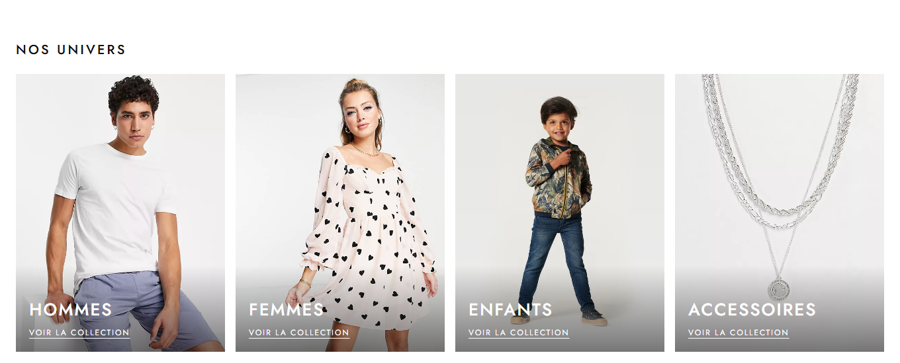
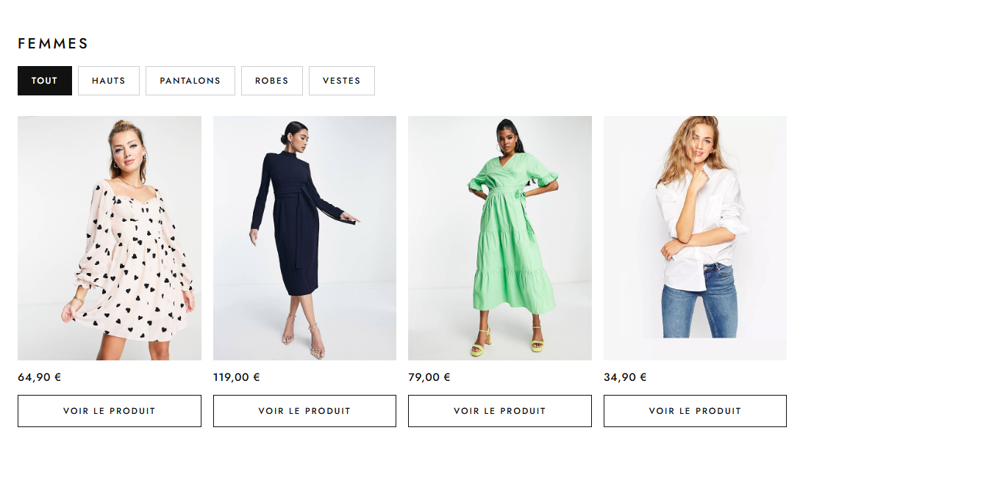
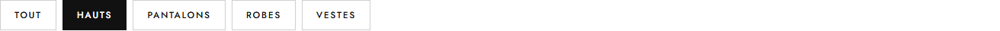
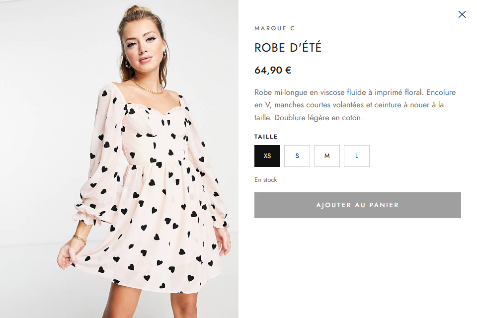
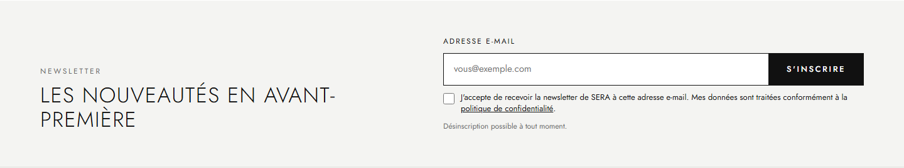
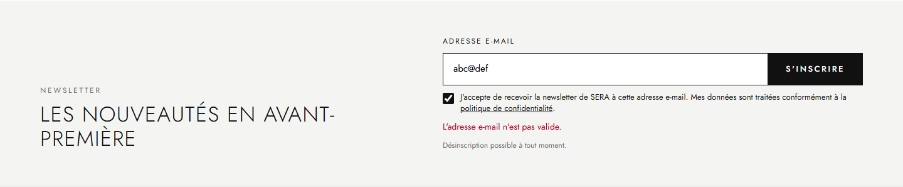
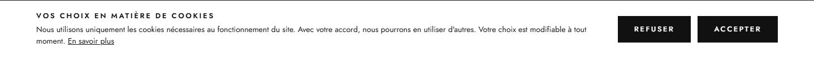
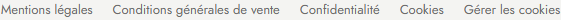

# Guide utilisateur du site SERA

Ce guide explique, pas à pas, comment utiliser le site de la boutique SERA : parcourir les collections, consulter un article, s'inscrire à la newsletter et gérer vos choix en matière de cookies.

## Sommaire

1. [Présentation du site](#1-présentation-du-site)
2. [Naviguer entre les catégories](#2-naviguer-entre-les-catégories)
3. [Filtrer par type de vêtement](#3-filtrer-par-type-de-vêtement)
4. [Consulter une fiche produit](#4-consulter-une-fiche-produit)
5. [S'inscrire à la newsletter](#5-sinscrire-à-la-newsletter)
6. [Gérer les cookies](#6-gérer-les-cookies)
7. [Accéder aux pages légales](#7-accéder-aux-pages-légales)

---

## 1. Présentation du site

Le site SERA présente les collections de la boutique. La page d'accueil se lit de haut en bas :

- **Le bandeau d'annonce**, tout en haut, rappelle les avantages de la boutique (livraison offerte dès 50 €, retours gratuits).
- **L'en-tête** reste affiché en haut de l'écran pendant que vous faites défiler la page. Il contient le logo SERA et la liste des catégories.
- **La vidéo d'ouverture** présente l'univers de la boutique.
- **Les engagements SERA** résument la livraison, les retours, les moyens de paiement et le service client.
- **« Nos univers »** présente chaque catégorie sous forme d'une grande image cliquable.
- **« Derniers arrivages »** affiche les huit articles les plus récents.
- **Le bandeau de collection** met en avant la collection du moment.
- **Le pied de page** regroupe la newsletter, les liens utiles et les pages légales.

Pour revenir à l'accueil à tout moment, cliquez sur le logo **SERA** en haut à gauche. La page remonte alors tout en haut et la sélection de catégorie est effacée.

Le site s'adapte à la taille de l'écran : il peut être consulté sur ordinateur, tablette ou téléphone.

---

## 2. Naviguer entre les catégories

Il existe deux façons d'ouvrir une catégorie.

**Depuis l'en-tête**

1. Repérez la liste des catégories dans la barre du haut.
2. Cliquez sur le nom de la catégorie qui vous intéresse.

La catégorie choisie apparaît en surbrillance, et la page descend automatiquement jusqu'à la liste de ses articles.

**Depuis la section « Nos univers »**

1. Faites défiler l'accueil jusqu'à « Nos univers ».
2. Cliquez sur l'image de la catégorie (mention « Voir la collection »).

Une fois une catégorie ouverte, la liste affiche son nom en titre, suivi des articles sous forme de vignettes. Chaque vignette montre la photo de l'article et son prix. En passant la souris sur la photo, le nom de l'article s'affiche.

Pour changer de catégorie, cliquez simplement sur une autre catégorie dans l'en-tête. Si vous êtes sur une autre page du site (par exemple « Qui sommes-nous »), le choix d'une catégorie vous ramène à l'accueil, directement sur ses articles.

> **À savoir :** lorsqu'aucune catégorie n'est choisie, la liste affiche les « Derniers arrivages ». Si une catégorie ne contient aucun article pour le moment, le message « Aucun produit dans cette catégorie. » s'affiche.

---

## 3. Filtrer par type de vêtement

Lorsque vous avez ouvert une catégorie, une rangée de boutons apparaît au-dessus des articles. Elle propose les types de vêtements présents dans cette catégorie (par exemple « Pulls », « Pantalons », « Vestes »).

1. Cliquez sur un type pour n'afficher que les articles correspondants. Le bouton actif est mis en évidence.
2. Cliquez sur **« Tout »** pour afficher de nouveau tous les articles de la catégorie.

Le filtre se remet automatiquement sur « Tout » quand vous changez de catégorie. Les types proposés dépendent de la catégorie ouverte : seuls ceux qui contiennent des articles sont affichés.

---

## 4. Consulter une fiche produit

1. Dans la liste des articles, cliquez sur le bouton **« Voir le produit »** sous la vignette.
2. Une fenêtre s'ouvre par-dessus la page avec le détail de l'article.

La fiche présente :

- la **photo** de l'article ;
- la **marque** et le **nom** de l'article ;
- le **prix**, en euros (par exemple « 89,00 € ») ;
- une **description** ;
- les **tailles** disponibles : cliquez sur une taille pour la sélectionner, elle est alors mise en évidence ;
- la **disponibilité** : « En stock » ou « Rupture de stock ».

Pour fermer la fiche, cliquez sur la croix en haut de la fenêtre, cliquez en dehors de la fenêtre (sur le fond sombre) ou appuyez sur la touche **Échap** de votre clavier.

> **À savoir :** la commande en ligne n'est pas encore ouverte. Le bouton « Ajouter au panier » est donc grisé sur les fiches. Pour toute question sur un article, contactez la boutique via les coordonnées indiquées dans les [mentions légales](#7-accéder-aux-pages-légales).

---

## 5. S'inscrire à la newsletter

La newsletter vous permet de recevoir les nouveautés en avant-première. Le formulaire se trouve en haut du pied de page, sous le titre **« Les nouveautés en avant-première »**.

1. Faites défiler la page jusqu'en bas.
2. Saisissez votre adresse e-mail dans le champ **« Adresse e-mail »**.
3. Cochez la case de consentement. Elle confirme que vous acceptez de recevoir les communications de SERA, conformément à la politique de confidentialité (un lien y mène).
4. Cliquez sur **« S'inscrire »**.

Un message de confirmation s'affiche : « Merci, votre inscription est enregistrée. »

Si l'inscription n'aboutit pas, un message en rouge vous explique pourquoi :

| Message affiché | Ce que cela signifie | Que faire |
|-----------------|----------------------|-----------|
| « Le consentement est obligatoire pour s'inscrire. » | La case de consentement n'est pas cochée. | Cochez la case, puis recommencez. |
| « L'adresse e-mail n'est pas valide. » | L'adresse est vide ou mal écrite. | Vérifiez-la (elle doit ressembler à `nom@domaine.be`). |
| « Cette adresse e-mail est déjà inscrite. » | Vous êtes déjà abonné(e) avec cette adresse. | Aucune action nécessaire. |

Vos données sont utilisées uniquement pour l'envoi de la newsletter. Pour connaître vos droits (accès, rectification, suppression) et la façon de les exercer, consultez la page **Confidentialité**.

---

## 6. Gérer les cookies

Lors de votre première visite, un bandeau s'affiche en bas de l'écran : **« Vos choix en matière de cookies »**. Le site n'utilise que les cookies nécessaires à son fonctionnement ; d'autres ne peuvent être utilisés qu'avec votre accord.

- Cliquez sur **« Accepter »** pour autoriser les cookies supplémentaires.
- Cliquez sur **« Refuser »** pour n'utiliser que les cookies nécessaires.
- Cliquez sur **« En savoir plus »** pour lire la page **Cookies**, qui détaille leur usage.

Votre choix est mémorisé sur votre appareil : le bandeau ne s'affiche plus lors de vos visites suivantes.

**Modifier votre choix à tout moment**

1. Faites défiler la page jusqu'au pied de page.
2. Dans la ligne du bas, cliquez sur **« Gérer les cookies »**.
3. Le bandeau réapparaît : choisissez de nouveau « Accepter » ou « Refuser ».

> **À savoir :** si vous videz les données de votre navigateur, ou si vous changez de navigateur ou d'appareil, le bandeau s'affichera de nouveau.

---

## 7. Accéder aux pages légales

Les pages légales sont accessibles depuis la ligne du bas du pied de page, sur toutes les pages du site.

| Lien | Contenu |
|------|---------|
| **Mentions légales** | Identité de la société, coordonnées, hébergeur du site. |
| **Conditions générales de vente** | Règles applicables aux achats. |
| **Confidentialité** | Données personnelles collectées, finalités et droits. |
| **Cookies** | Cookies utilisés et façon de gérer votre choix. |

La page **« Qui sommes-nous »**, qui présente la boutique, est accessible depuis la colonne « À propos » du pied de page.

Chaque page légale s'ouvre automatiquement en haut, quel que soit l'endroit du pied de page où vous avez cliqué.

---

## Besoin d'aide ?

Pour toute question sur le site ou sur vos données personnelles, contactez SERA aux coordonnées indiquées dans les **Mentions légales**.
